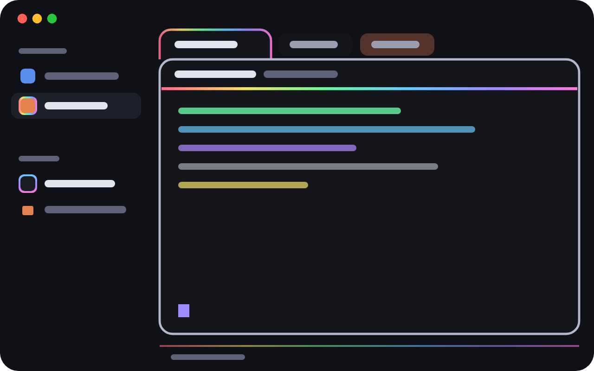

# RGB

[](https://github.com/dmazlum/herdr-rgb/actions/workflows/ci.yml)

A calm RGB layout for the [Herdr](https://herdr.dev) app. Dark and clean, with color only
where it says something: what is focused, what is working, what needs you and what just
finished.



Requires the **Herdr desktop app 0.1.10+**.

## Features

- **Color-cycling focus frame.** While the focused pane's agent works, its frame slowly
  turns through the hues. Otherwise it rests silver.
- **Status you can see at a glance.** Under each pane's header, a swaying rainbow means
  working, a warm pulse means it needs you, green means done.
- **Agent finished.** A soft streak of rainbow light runs once along the pane's header, or
  along its tab if it's in the background.
- **Quiet sidebar.** Only the shown space and busy agents get a rainbow ring drifting
  across them; each kind of agent has its own hues. An agent that needs you pulses
  warm instead, and so does a small dot on its space.
- **Tabs that join the pane.** The active tab sits on its card with a faint rainbow
  outline drifting along it; a background tab whose agent needs you glows.
- **Search in the tab bar.** A search button in the middle of the tab bar opens the
  command palette. The +, Files and Changes buttons stand out as chips.
- **Light and dark.** Follows the system's appearance with a matching light theme, and a
  faint violet veil behind the cards in both.
- **Calm mode.** `cmd-shift-g` turns the decoration off and keeps the signals.

## Install

The layout is a folder laid out like `~/.config/herdr-app`. Ask your agent to add it from
this repository, or by hand:

1. Copy `layouts/rgb.json` and `layouts/rgb.svg` to `~/.config/herdr-app/layouts/`.
2. Copy `themes/rgb.json` and `themes/rgb-light.json` to `~/.config/herdr-app/themes/`
   (before the layout: Herdr rejects a layout whose theme it hasn't seen).
3. Copy the five `mods/rgb-*` folders to `~/.config/herdr-app/mods/`.
4. Merge `keys.json` into `~/.config/herdr-app/keys.json` (it adds `cmd-shift-g`, only for
   this layout).
5. Run `herdr-app check ~/.config/herdr-app/mods/<name>` for each mod, then
   `herdr-app do layout.switch '{"name":"rgb"}'`.

`ctrl-shift-l` switches back to your own layout. Deleting the files removes it.

## Cost

Rainbow lines, rings and pulses are native Herdr animations: they run without the mods'
scripts and stop when not shown. Two things use the script:

- The focus frame's color goes through `layout.set` every 1.2s, only while the focused
  pane's agent works and the window is in front. It writes `layouts/rgb.json` each time,
  and holds off for two steps after any other layout change so it never undoes one.
- A finished-agent streak redraws about 34 times over a second, once per finish.

Calm mode (`cmd-shift-g`) stops both and stills the rainbows.

## Notes

- The five mods are copies of Herdr's own `spaces`, `agents`, `tabs`, `pane` and
  `workspace-status`. Herdr's later changes to those don't reach them.
- `RECIPE.md` describes the layout in full, so an agent can rebuild it from scratch.

## Development

```sh
npm test
npm run sync               # copy mods, theme and preview into ~/.config/herdr-app
npm run sync -- --layout   # also overwrite layouts/rgb.json
```

The app reloads a mod within a second of a sync. Copy, don't symlink: Herdr doesn't
reload a symlinked mod folder and doesn't load its images.

The tests stub Herdr's built-in modules to check the shared helpers, and check that the
layout, theme, keys and mods agree with each other.

## License

MIT
