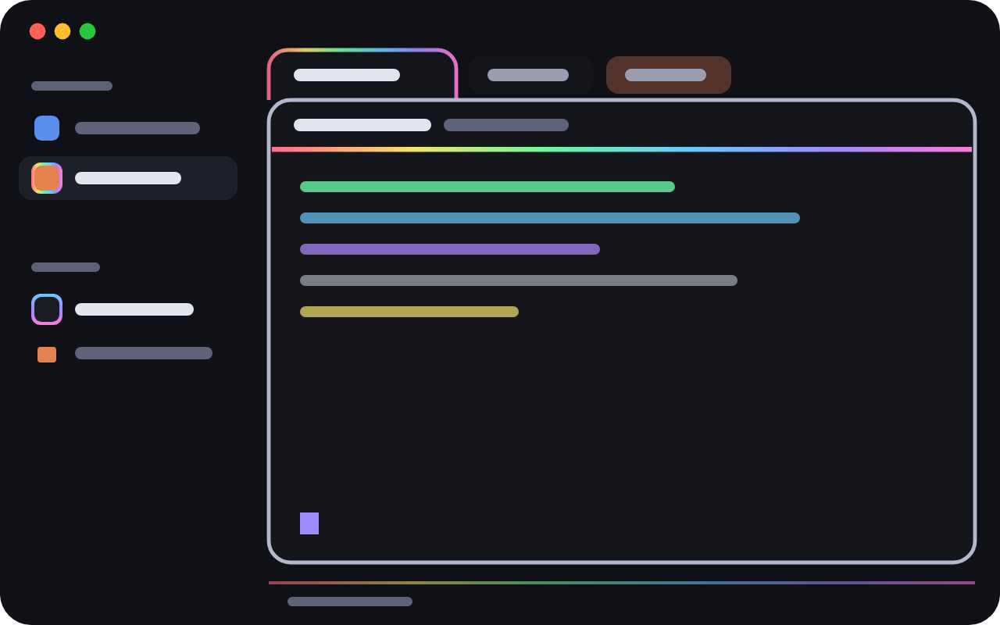

# RGB

A calm, dark Herdr layout with restrained RGB light. While the focused pane's agent works,
its frame slowly cycles through the hues; otherwise it rests silver. Rainbow outlines
drift around the active tab, the shown space and busy agents; thin rainbow lines sway
under busy panes. Whatever needs you pulses warm. When an agent
finishes, a soft streak of rainbow light runs once along its header or its tab. One key,
`cmd-shift-g`, turns all the decoration off and keeps the signals.

## What you see

The window follows the system's appearance: `themes/rgb.json` in dark mode,
`themes/rgb-light.json` in light mode (same color names: canvas and chrome `#eceef4`, cards
`#f7f7fb`, borders `#d3d6e2`, `accent` `#7c6cf0`, `working` `#2e7fc2`, `blocked` `#e0663a`,
`done` `#2f9e63`, ink `#2a2c38`). The dark theme (`rgb`): background `#15161c`,
foreground `#e2e4ee`, and one flat chrome tone `#101116` for `canvas` and `chrome`, so the
sidebar, tab bar and status bar read as one surface and the terminal cards (`#15161c`)
sit on it. Borders `#22242e`, `raised` `#1b1d25`, `selected` `#1e2029`, `muted` `#9a9db0`,
`dim` `#5f6377`, `accent` `#9d8bff`, `working` `#6bc8ff`, `blocked` `#ff8a5c`, `done`
`#6bf5a3`. ANSI colors are soft neon: `#3a3d4d #ff6b8b #6bf5a3 #f5e26b #6bc8ff #b18bff
#5ef0e0 #d9dbe6`, bright `#6c7086 #ff8fa6 #92f8bb #f8ea94 #94d8ff #c8acff #8af5ea
#ffffff`. Cursor `#9d8bff`, selection `#2e2a45`. No title bar; macOS traffic lights at
12, 16. No divider between sidebar and work area. The work area behind the cards carries
a faint violet veil: a gradient from `#9d8bff00` to `#9d8bff12` at 160°, transparent
enough for both themes.

Left to right:

- **Sidebar**, 268px (44–480), `chrome`:
  - Brand row (46px) and footer (69px): Herdr's own `workspace-chrome`.
  - **Spaces** (`rgb-spaces`): header "Spaces" in 11.5px `dim` with a **+** button: 24px,
    7px radius, `raised` background, `foreground` icon at 15px, `selected` on hover,
    tooltip "New space". Each space row shows its initial in a 22px box (6px radius): the
    space's color fill with a white 10.5px bold letter. Only the shown space's box has a
    ring: 1.5px of rainbow drifting across it (opacity 0.9, there and back in 10s), then a
    1px `canvas` hairline, then the fill (17px). The selected row is `selected`; no other
    bar or marker. A space where an agent needs you gets an 8px `blocked` dot on its box's
    top-right corner, edged in `canvas`, pulsing 0.45↔1 every 1.4s.
  - **Agents** (`rgb-agents`): header "Agents" with a sort button in the same style as
    **+** (24px, `raised`, white clock icon). Each row's icon (14px) sits in a 22px slot.
    A busy agent (working, blocked or done) gets a box: `raised` fill, 6px radius,
    ringed by 1.5px of rainbow drifting across it (opacity 0.9 focused, 0.45 otherwise,
    there and back in 10s). Each kind of agent's rainbow is shifted to its own hues:
    Claude 0°, Codex 120°, others 240°. An agent
    that needs you has a `blocked` ring pulsing 0.3↔1 every 1.4s instead.
    An idle agent shows just its icon, no box, no ring.
- **Work column**:
  - **Tab bar** (`rgb-tabs`), 48px, `chrome`, no bottom border. Tabs sit on the bar's
    bottom edge. The active tab is 36px tall, 14px side padding, 13.6px text, 16px icon,
    names up to 220px; it is filled `background`, rounded 10px on top only, and joins the
    card below. Its outline is a faint rainbow drifting along it (opacity 0.45, there and
    back in 14s), as thick as the pane frame (1.5px), corners included. Other tabs are
    32px tall with 4px under them, 8px radius, `surface` fill, `muted` text; `selected`
    and `foreground` on hover. A background tab whose agent needs you glows `blocked`
    (opacity 0.06↔0.3, 1.4s). In the middle of the bar sits a search button: 300px ×
    30px,
    8px radius, `background` fill, 1px `border`, a 14px search icon, "Search commands"
    and "⌘⇧P" in `dim` (`muted` text and a `dim` border on hover); the tabs stop 12px
    short of it. A click runs `app.palette`: Herdr's command palette opens with the
    keyboard, ready to type. The **+**, Files and Changes buttons are 28px
    chips that line up with the tabs: 7px radius, `raised` fill, 1px `border`,
    `foreground` text and icons, `selected` on hover; an open panel's button is `selected`
    with an `accent` border.
  - **Panes** (`work-body`: padding 0 top/bottom, 10px sides): cards with 10px gaps, 12px
    radius, `background` fill, 1px `border`, focus frame 1.5px. Terminal padding 16×12.
    Each card has a 32px header (`rgb-pane`): program icon, name, folder in `dim`, status
    on the right; split, zoom and close buttons on hover. Under the header, a line that
    tells the agent's state (see below).
  - **Status bar** (`rgb-status`), 36px: 8px of `chrome` under the cards, then the bar
    (12px text, 12px side padding, 8px gaps). Its facts sit in chips: 20px tall, 8px side
    padding, 6px radius, `raised` fill, 1px `border`, `foreground` text, icons 13px in
    `muted`. The chips are the machine ("This computer" or its name, monitor or server
    icon), the branch (when there is one), and the agents: a 6px dot, "N agents", and
    "· N working" in `working` while any works. When agents need you, one more chip in
    `blocked` (fill `blocked` at 15%, border at 40%) says "N needs you". "⌘ Shift P
    commands" stays on the right in `dim`.

## How it behaves

- **Focus frame.** 1.5px. While the focused pane's agent is working and the window is in
  front, it steps through 18 hues, one every 1.2s (about a 22s turn, `hsl(h, 82%, 66%)`).
  Otherwise it rests on `#b4b8cc`. Right after any other layout change (a panel shown,
  the sidebar resized) it holds off for two steps.
- **Header line, by status:**
  - working: a 2px rainbow swaying sideways and back (9s), opacity 0.9 on the focused
    pane and 0.45 on others;
  - blocked ("Needs you"): a 2px `blocked` line pulsing 0.25↔1 every 1.4s;
  - done: a 2px `done` line, 0.85 focused / 0.5 otherwise;
  - idle or no agent: a 1px `border` hairline at 0.6.
- **Agent finished.** When a pane's agent goes from working to done or idle, a soft streak
  of light runs once along that header's underline, left to right, in about 1.1s with
  ease-in-out: 2px tall, 30% of the header wide (at least 160px), 32 rainbow slices whose
  opacity follows a sine, full in the middle and fading to nothing at both ends. A faint
  glow of the same streak (peak opacity 0.1) passes over the header behind the text. If
  that agent's tab is in the background of the shown space, a 120px streak runs along the
  tab's bottom edge the same way. Going to
  blocked doesn't sweep, and neither does a finish more than 4s old (its tab's
  `changed_at`): one that happened while its space or tab wasn't shown stays quiet when
  you come back.
- **Status bar.** The agents dot is `working` and pulses (0.35↔1, 1.6s) while any agent
  works; "needs you" pulses 0.45↔1 every 1.4s.
- **Colors that mean one thing.** Rainbow means working; warm `blocked` pulses mean an
  agent needs you (pane header, background tab, agent ring, space dot); green means done.
- **Calm mode.** `cmd-shift-g` (only in this layout) toggles shared `rgb.calm`. Calm:
  every rainbow becomes a plain `border` line or ring, the frame rests on `#b4b8cc`, and
  no sweeps play. The warm pulses for "needs you" stay.
- **Space colors.** A space keeps its color. Unlike Herdr's own spaces list, `rgb-spaces`
  never drops a stored color for a space it doesn't see at that moment (while the window
  reloads the list can be briefly empty, and dropping then re-deals every color); it only
  gives a color to a space without one.
- Everything else is Herdr's: clicks, drag to reorder, sort menu, Files and Changes.

## Built from

- `layouts/rgb.json`: Herdr's `main` layout cloned, then: root
  `theme: {"light": "rgb-light", "dark": "rgb"}`, `work-body` background gradient,
  `preview: "layouts/rgb.svg"`, no root divider, `terminal_padding: [16, 12]`; `tabs`
  48px, `status` 36px, `work-body` padding `[0, 10]`, gap 10; the tab block's pane
  `gap: 10, radius: 12, border 1 border, focus 1.5 #b4b8cc, header 32px top always`;
  blocks point at `rgb-spaces`, `rgb-agents`, `rgb-tabs`, `rgb-pane` (pane header) and
  `rgb-status`. Brand, footer, Files and Changes stay Herdr's (`workspace-chrome`,
  `files`, `changes`).
- Each `rgb-*` mod is a `mod.clone` of Herdr's `spaces`, `agents`, `tabs`, `pane` and
  `workspace-status`, changed only where this recipe says.
- `rgb.js`, the same file in every mod: `hsl()`, `paneFrame()`, `drift()` (48 solid hue
  slices twice over, filling its parent and swaying with `loop("left")`, hues shifted by
  `offset`), `outline()` (the layers of a rounded rainbow outline: drift or warm pulse,
  optional hairline, inset fill, corner pieces; `sides:
  "top"` for one open at the bottom, `plain` for the fill alone), `ring()` (a box made of
  those layers), `rainbow()` (48 solid slices twice over, swaying with
  `loop("left")`), `sweep()` and `Sweeps` (the finished streak), and `calm()`.
- `rgb-status` runs a 1.2s `cx.timer.every`: it reads `layout()`, and when the frame's
  color should change, sets the tab block's `pane.focus` and writes the tree back with
  `run("layout.set", { layout })`. It compares the layout without `focus` with the last
  one it saw, and on any other change holds off for two steps. It also listens with
  `nextCommand()` for `calm`, which flips `setShared("rgb.calm")`. No other mod writes
  the layout.
- Rounded rainbow outlines (active tab, space and agent rings) are `outline()` layers: a
  drifting rainbow behind an inset fill, with small SVG corner pieces
  (`corner-tl/tr/bl/br.svg`, a square minus a quarter circle, tinted with `text_color`) in
  the color behind them.
- `herdr` functions used: `theme`, `layout`, `run`, `window`, `agents`, `spaces`, `panes`,
  `shared`, `setShared`, `nextCommand`, `machines`, plus what the cloned mods already used.
  Commands: `layout.set`, plus the cloned mods' own. No programs, network or files.
- `keys.json`: `{ "layout:rgb": { "cmd-shift-g": "rgb-status.calm" } }`.

## Watch out

- `.bg()` takes a color only, no gradient: every rainbow is solid slices.
- `loop` animates opacity, width, height, left and top only, never color, and it goes there
  and back: a strip can sway but not flow one way.
- `spin()` keeps going one way, but it turns only one-color `svg` masks (a full-color
  `image()` stays still), and Herdr draws a turning element above everything else in its
  block, so no fill or text can sit in front of it. A rainbow wheel behind an outline
  covers the whole box. Outlines therefore use a swaying strip of `div`s, which later
  siblings cover normally.
- Svg masks are drawn above `div` backgrounds whatever their order; a `div` fill can't
  cover an svg.
- Animating the frame with `layout.set` rewrites the whole layout: it can undo a layout
  change still on its way, and it redraws every mod that reads `layout()`. Keep it slow,
  only for the focused working agent, only with the window in front, and hold off after
  any other change.
- `transition` and `spring` on `left` didn't glide in this Herdr version; the value jumped.
  The finished sweep steps itself with `cx.spawn` and `cx.sleep(33)` for 34 frames,
  counting frames. A version that timed itself with `Date.now()` ended at once.
- `overflow_hidden` clips to a rectangle, not to rounded corners, and children placed at
  negative offsets are cut off. That is why the outlines use an inset fill plus corner
  pieces. A corner piece must match the color behind it: the tab bar `chrome`, or the
  row's `selected`/`chrome`, and `hover` while the pointer is on an agent row. Rows that
  move get no hover-out, so the agents mod forgets the hovered row whenever the order
  changes. The streak on a background tab runs inside an area 8px in from each side, clear
  of its rounded corners, over the tab's measured width.
- A ring's own hue passes every fill color: without the `canvas` hairline a space's ring
  disappears into its fill at that moment.
- Animations that start together stay in phase; there is no start offset for `loop`. To
  make rings differ, shift their hues instead.
- Don't make the tab bar's search a text box that opens the palette as you type. A
  dialog opened from a text input's change event doesn't get the keyboard until its own
  focus retry (Herdr's palette retries after 600ms), so it looks frozen; passing the keys
  on through shared state redraws every mod on each key, so arrows stutter. Opened by a
  click or a command, the palette has the keyboard at once. (Herdr's palette can't take a
  starting query, and `mod.clone` won't copy it.)
- A layout naming a theme file Herdr hasn't seen yet is rejected. Copy the theme first;
  if the layout was already rejected, change the layout file once more so it re-reads it.
- A sweep's task must survive its view closing: a closed view's `cx` throws, so the loop
  catches that and clears its entry.
- Tab and pane status are only seen while drawn: compare a finish with the tab's
  `changed_at`, or a finish missed while hidden plays when you return.
- Install mods as copies, not symlinks. Herdr doesn't reload a symlinked mod folder when
  its files change, and doesn't load `image()` files through it (the rings and the tab
  outline vanish). `npm run sync` copies the repo into the app's home.
- `setShared(key, null)` empties a key but cannot remove it.
- `rgb.js` is copied into every mod (a mod can't import another's file). Keep the copies
  identical; the tests check.
- These are clones: Herdr's updates to `spaces`, `agents`, `tabs`, `pane`,
  `workspace-status` don't reach them.
- Herdr's own spaces list drops the color of any space it doesn't see and re-deals; a
  reload that briefly shows no spaces re-deals them all. `rgb-spaces` drops colors only
  when the list is surely whole (not empty, every machine connected and loaded).

## Done when

- `herdr-app check` passes for all five `rgb-*` mods, and `layout.switch {"name":"rgb"}`
  shows no errors in `herdr-app status`.
- With the focused pane's agent working and the window in front, `layouts/rgb.json`'s
  focus color changes every ~1.2s; with that agent idle, it is `#b4b8cc` and the file
  stops changing. Toggling the Files panel while it cycles never gets undone.
- A working agent's header has a moving rainbow line; an idle shell's has a thin gray one.
- Only the shown space's initial has a ring; only busy agents have boxes.
- The active tab has a continuous rainbow outline with round corners and no gray, and its
  colors move.
- Hovering a busy agent's row shows no dark corners around its ring.
- Starting a short agent task in a background tab sweeps that tab once when it finishes.
- `cmd-shift-g` removes every rainbow and stops the frame; pressing it again brings them
  back.
- Clicking the tab bar's search button opens the command palette, and typing goes
  straight into it.
- `npm test` passes.
